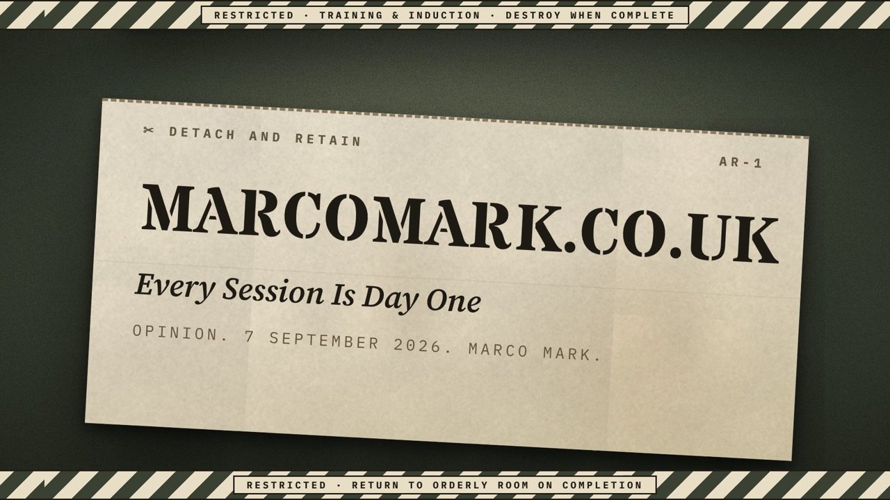
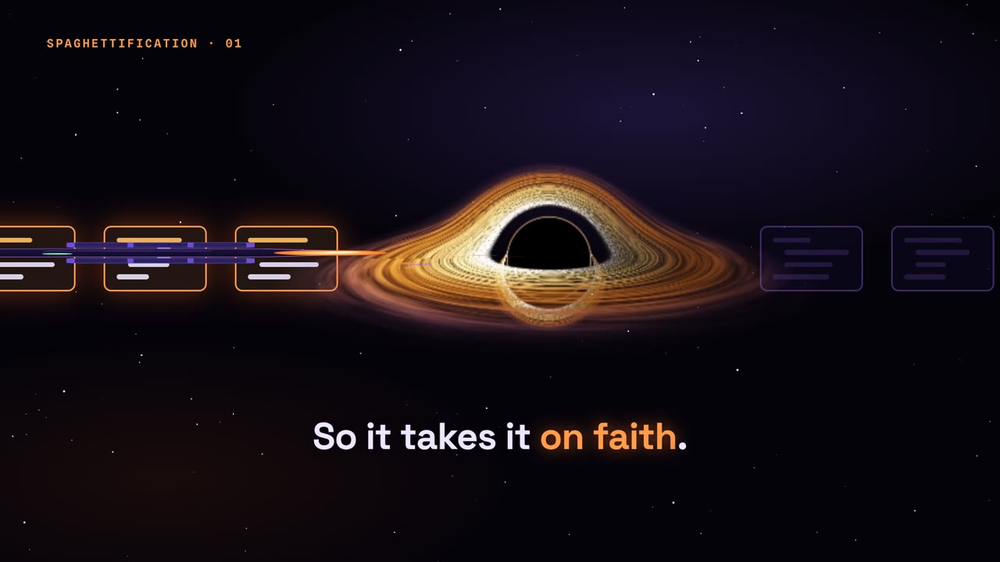

# Showcase

Short animated stories for social posts, built with [Remotion](https://www.remotion.dev). Each story is a React component that renders to MP4.

Like [marcomark.co.uk](https://marcomark.co.uk), there's no house style. Every story gets a look that suits it, and two stories sitting next to each other shouldn't look like a set.

## Watch

| Story | Vertical | Landscape | Source |
|---|---|---|---|
| Every Session Is Day One | [MP4](renders/day-one/vertical.mp4) | [MP4](renders/day-one/landscape.mp4) | [blog post](https://marcomark.co.uk/blog/every-session-is-day-one.html) |
| Spaghettification 1/4: The Dependency Singularity | [MP4](renders/spaghettification/01-dependency-vertical.mp4) | [MP4](renders/spaghettification/01-dependency-landscape.mp4) | [blog post](https://marcomark.co.uk/blog/spaghettification.html) |
| Spaghettification 2/4: The Memory Nebula | [MP4](renders/spaghettification/02-memory-vertical.mp4) | [MP4](renders/spaghettification/02-memory-landscape.mp4) | [blog post](https://marcomark.co.uk/blog/spaghettification.html) |
| Spaghettification 3/4: The Data Void | [MP4](renders/spaghettification/03-data-vertical.mp4) | [MP4](renders/spaghettification/03-data-landscape.mp4) | [blog post](https://marcomark.co.uk/blog/spaghettification.html) |
| Spaghettification 4/4: The False Horizon | [MP4](renders/spaghettification/04-false-horizon-vertical.mp4) | [MP4](renders/spaghettification/04-false-horizon-landscape.mp4) | [blog post](https://marcomark.co.uk/blog/spaghettification.html) |





## Running it

```bash
npm install
npm run dev       # Remotion Studio, scrub through and tweak live
npm run render    # full-quality MP4s to out/ (not committed)
npm run still     # a PNG thumbnail to out/
```

Remotion downloads its own headless Chrome the first time you render.

## Layout

- `src/stories/<story>/` one folder per video, including its own look (colours, fonts, effects)
- `src/kit/` style-free helpers only: sizing that works in both shapes, and the list of formats
- `src/Root.tsx` registers each story in 9:16 (phones) and 16:9 (desktop timeline)
- `public/fonts/` fonts bundled so renders never depend on a font CDN, each with its licence
- `renders/` smaller preview copies of each video (720p, a few MB), committed so they're easy to watch. Full-quality files come from `npm run render`
- `src/stories/spaghettification/` a four-part series, one clip per black hole in the post. The same character runs through all four: a probe that can only see what its torch lights (`probe.tsx`). The black hole in part one is a ray-traced WebGL shader (`BlackHole.tsx`), so renders need `--gl=swangle` in a headless container
- `scripts/` generators for the sound effects and paper textures, so there are no samples or stock images to license

## Licences

Remotion is free for individuals and companies of up to three people. See [remotion.dev/license](https://www.remotion.dev/license). IBM Plex Mono, Space Grotesk and Spline Sans Mono are under the SIL Open Font License, included alongside the font files.
