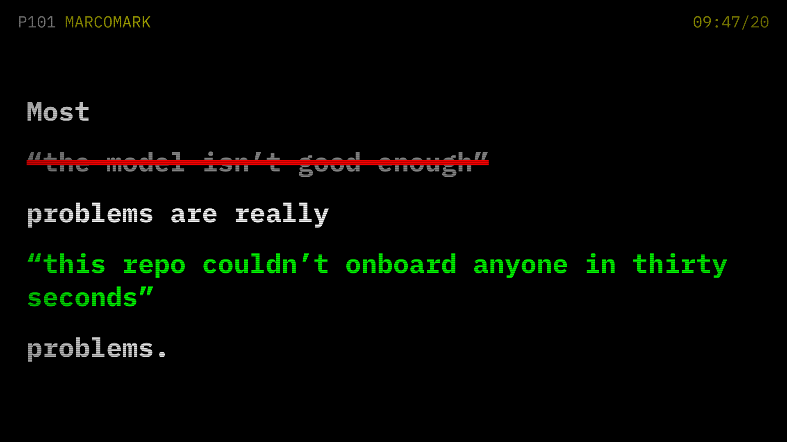

# Showcase

Short animated stories for social posts, built with [Remotion](https://www.remotion.dev). Each story is a React component that renders to MP4.

Like [marcomark.co.uk](https://marcomark.co.uk), there's no house style. Every story gets a look that suits it, and two stories sitting next to each other shouldn't look like a set.

## Watch

| Story | Vertical | Landscape | Source |
|---|---|---|---|
| Every Session Is Day One | [MP4](renders/day-one/vertical.mp4) | [MP4](renders/day-one/landscape.mp4) | [blog post](https://marcomark.co.uk/blog/every-session-is-day-one.html) |



## Running it

```bash
npm install
npm run dev       # Remotion Studio, scrub through and tweak live
npm run render    # writes MP4s to renders/
npm run still     # writes a PNG thumbnail to renders/
```

Remotion downloads its own headless Chrome the first time you render.

## Layout

- `src/stories/<story>/` one folder per video, including its own look (colours, fonts, effects)
- `src/kit/` style-free helpers only: sizing that works in both shapes, and the list of formats
- `src/Root.tsx` registers each story in 9:16 (phones) and 16:9 (desktop timeline)
- `public/fonts/` fonts bundled so renders never depend on a font CDN, each with its licence
- `renders/` the finished videos, committed so they're easy to grab

## Licences

Remotion is free for individuals and companies of up to three people. See [remotion.dev/license](https://www.remotion.dev/license). IBM Plex Mono is under the SIL Open Font License, included alongside the font files.
